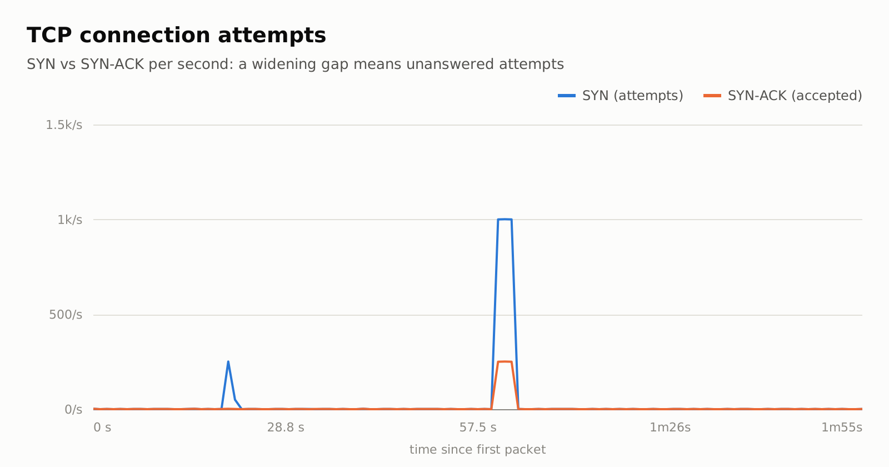

# pcapan: analizator ruchu TCP/UDP z plików pcap

`pcapan` to narzędzie wiersza poleceń dla systemu Linux, napisane w C11. Wczytuje przechwycony ruch z pliku `.pcap`, odtwarza każdą rozmowę TCP i UDP, oznacza podejrzany lub nieprawidłowy ruch i tworzy:

- `report.pdf`: wielostronicowy raport z podsumowaniem przechwytu, ustaleniami uszeregowanymi według ważności, wszystkimi wykresami i największymi przepływami
- osobny plik PNG dla każdego wykresu: ruch w czasie, próby połączeń TCP, podział protokołów, najaktywniejsze hosty, najważniejsze usługi, rozmiary pakietów i czasy trwania połączeń

```
$ ./pcapan -o out samples/attack.pcap
samples/attack.pcap: 13,616 packets, 8.0 MB, 3504 flows, 3099 hosts
  [HIGH  ] TCP port scan: 192.168.1.66 probed 300 different TCP ports on 10.0.0.5 ...
  [HIGH  ] Possible SYN flood: 3001 connection attempts to 10.0.0.5:80 never completed ...
  [HIGH  ] Possible UDP amplification: 1 UDP flow(s) on DNS/NTP/SNMP/SSDP/memcached ports ...
  [MEDIUM] Connections with heavy retransmission: ...
  [MEDIUM] UDP fan-out: 192.168.1.77 sent UDP traffic to 80 different hosts ...
  [LOW   ] TCP zero-window events: ...
  [LOW   ] Traffic spike: ...
  [INFO  ] Unencrypted login protocol: 1 Telnet session(s) on TCP port 23 ...
Report written to out/report.pdf
```

Przykładowy raport dla `samples/attack.pcap` znajduje się w [`docs/example_report.pdf`](docs/example_report.pdf).



## Kompilacja

Jedyną zależnością jest **Cairo**, lekka biblioteka grafiki 2D dostępna w każdej dystrybucji Linuksa. Generuje zarówno wykresy PNG, jak i raport PDF. Razem z nią instaluje się fontconfig, jej biblioteka do konfiguracji czcionek.

```sh
# Debian / Ubuntu
sudo apt install build-essential pkg-config libcairo2-dev
# Fedora
sudo dnf install gcc make pkgconf-pkg-config cairo-devel

make            # buduje ./pcapan
```

Kod kompiluje się bez ostrzeżeń z flagami `-std=c11 -Wall -Wextra -Wpedantic -Wshadow`.

## Użycie

```
pcapan [-o KATALOG] [-q] PLIK.pcap

  -o KATALOG  katalog wyjściowy (domyślnie: pcapan_out, tworzony, jeśli nie istnieje)
  -q          tryb cichy: nie wypisuje podsumowania w terminalu
  -h          pomoc
  -V          wersja
```

Własny ruch możesz przechwycić poleceniem `sudo tcpdump -i any -w capture.pcap`. Pliki w formacie pcapng, domyślnym dla Wiresharka, są wykrywane i odrzucane z odpowiednim komunikatem. Najpierw przekonwertuj je poleceniem `editcap -F pcap in.pcapng out.pcap`.

## Testowanie

```sh
make samples   # generuje 4 syntetyczne przechwyty w samples/ (Python 3, tylko biblioteka standardowa)
make test      # uruchamia pcapan na każdym z nich
make asan      # przebudowuje z AddressSanitizer + UndefinedBehaviorSanitizer
```

| Próbka | Co sprawdza |
|---|---|
| `normal.pcap` | dwie minuty ruchu WWW, DNS, SSH i NTP, IPv4 i IPv6 |
| `attack.pcap` | ten sam ruch oraz skanowanie portów, SYN flood, UDP fan-out, amplifikację DNS, odbiorcę z zerowym oknem, połączenie ze stratami pakietów i logowanie przez Telnet |
| `malformed.pcap` | uszkodzone nagłówki IP/TCP, ramkę krótszą niż nagłówek Ethernet, plik ucięty w połowie pakietu |
| `bigendian_ns.pcap` | kolejność bajtów big-endian, znaczniki czasu w nanosekundach, typ łącza Linux cooked capture |

Narzędzie sprawdzono programem valgrind (brak wycieków i błędów) oraz z ASan/UBSan na wszystkich próbkach. Uruchomiono je też na plikach pustych, zawierających sam nagłówek, losowych i zmodyfikowanych fuzzingiem. Błędne dane wejściowe nigdy nie powodują awarii: program kończy się błędem albo analizuje wszystko, co udało się odczytać.

## Architektura

```
pcap.c  ->  decode.c  ->  analysis.c  ->  anomaly.c  ->  charts.c  ->  report.c
 odczyt      parsowanie    przepływy i     reguły        wykresy      raport
 rekordów    nagłówków     statystyki      detekcji      PNG (Cairo)  PDF (Cairo)
```

| Plik | Odpowiedzialność |
|---|---|
| `pcap.c` | Bezpośredni odczyt klasycznego formatu pcap. Obsługuje obie kolejności bajtów, znaczniki czasu w µs i ns oraz wykrywa ucięte pliki. |
| `decode.c` | Parsuje Ethernet (ze znacznikami VLAN), Linux SLL/SLL2, surowe IP i BSD loopback, następnie IPv4 i IPv6 (wraz z nagłówkami rozszerzeń i fragmentami), a na końcu TCP i UDP. Każdy odczyt jest sprawdzany pod kątem granic bufora. |
| `analysis.c` | Tablica przepływów indeksowana 5-krotką, w której oba kierunki trafiają do jednego przepływu. Śledzi też oś czasu z rozdzielczością sekundową, histogram rozmiarów pakietów, stan uzgadniania połączeń TCP i retransmisje. Po ostatnim pakiecie agreguje statystyki hostów i usług. |
| `anomaly.c` | Reguły detekcji. Każda to udokumentowany próg zdefiniowany na początku pliku. |
| `charts.c` | Siedem wykresów. Każdy to jedna funkcja rysująca na `cairo_t`. |
| `report.c` | Układ PDF: zawijanie tekstu, podział na strony, etykiety ważności, tabela przepływów. |
| `main.c` | Obsługa wiersza poleceń i główny potok przetwarzania. |

### Decyzje projektowe

- **Bez libpcap.** Format pliku to 24 bajty nagłówka pliku i 16 bajtów na każdy pakiet. Odczytywanie go bezpośrednio usuwa zależność i daje narzędziu pełną kontrolę nad uszkodzonymi danymi.
- **Przetwarzanie strumieniowe.** Pakiety są przetwarzane pojedynczo i nigdy nie są przechowywane. Zużycie pamięci rośnie z liczbą przepływów i czasem trwania przechwytu (jeden mały rekord na sekundę), a nie z rozmiarem pliku.
- **Jedna ścieżka rysowania dla PNG i PDF.** Każdy wykres jest rysowany na stałym, logicznym płótnie 800×420. Przy eksporcie do PNG płótno jest skalowane 2× na powierzchnię obrazu. W raporcie jest pomniejszane na stronę PDF i pozostaje grafiką wektorową, więc wykresy są ostre przy każdym powiększeniu.
- **Przepływy dwukierunkowe.** Skrót (hash) jest liczony z obu punktów końcowych w posortowanej kolejności, więc A→B i B→A trafiają do tego samego kubełka. Strona „a” przepływu to ta, która wysłała pierwszy pakiet, zwykle klient.
- **Agregacja przez sortowanie.** Ranking hostów i usług powstaje przez utworzenie jednego rekordu na każdy punkt końcowy przepływu, posortowanie ich i scalenie sąsiadów. To prostsze niż dodatkowe tablice mieszające i wystarczająco szybkie, bo wykonuje się tylko raz.
- **Wyjaśnialne reguły.** Każde ustalenie podaje liczby, które je wywołały, więc czytelnik może je ocenić sam, zamiast ufać jakiejś punktacji.

### Reguły detekcji

| Ustalenie | Reguła | Ważność |
|---|---|---|
| Skanowanie portów TCP | jedno źródło wysyła SYN do co najmniej 15 różnych portów jednego hosta i żadne z tych połączeń nie zostaje nawiązane | wysoka |
| Przeszukiwanie hostów (host sweep) | jedno źródło próbuje tego samego portu na co najmniej 15 hostach, nie nawiązując połączenia | wysoka |
| SYN flood | co najmniej 100 nieukończonych uzgodnień połączenia z jedną usługą. Raport podaje liczbę różnych źródeł; wiele źródeł sugeruje fałszowanie adresów | wysoka |
| Amplifikacja UDP | przepływ DNS, NTP, SNMP, SSDP, LDAP, chargen lub memcached, w którym serwer wysyła co najmniej 10× więcej bajtów, niż zażądano, i co najmniej 100 KB | wysoka |
| Wysoki odsetek retransmisji | co najmniej 3% segmentów danych TCP to retransmisje | średnia |
| Połączenia ze stratami | przepływy z co najmniej 10 retransmisjami, stanowiącymi co najmniej 10% ich pakietów | średnia |
| UDP fan-out | jedno źródło wysyła ruch UDP do co najmniej 50 hostów | średnia |
| Zerowe okno | odbiorca co najmniej 3 razy ogłasza zerowe okno odbioru | niska |
| Wiele resetów | co najmniej 10 nawiązanych połączeń, stanowiących ponad 20% wszystkich, kończy się pakietem RST zamiast FIN | niska |
| Skok ruchu | sekunda z ruchem ponad 10× większym od mediany i większym niż średnia + 4σ (wymaga co najmniej 30 s przechwytu) | niska |
| Nieszyfrowane logowanie | ukończone sesje FTP, Telnet, POP3 lub IMAP | informacyjna |
| Problemy z przechwytem | uszkodzone pakiety lub ucięty plik | informacyjna |

Segment jest uznawany za retransmisję, gdy jego zakres numerów sekwencyjnych kończy się na najwyższym numerze sekwencyjnym już widzianym w danym kierunku lub przed nim. Arytmetyka numerów seryjnych poprawnie obsługuje przepełnienie (zawinięcie) numerów sekwencyjnych.

## Ograniczenia

- Obsługiwany jest tylko klasyczny format pcap. Pliki pcapng są wykrywane i trzeba je najpierw przekonwertować.
- Brak składania strumieni TCP i analizy warstwy aplikacji. Analiza opiera się na nagłówkach.
- Fragmenty IP po pierwszym są liczone, ale nie są składane.
- Progi to stałe zdefiniowane w `src/anomaly.c`. W bardzo dużych lub bardzo małych sieciach mogą wymagać dostrojenia.
